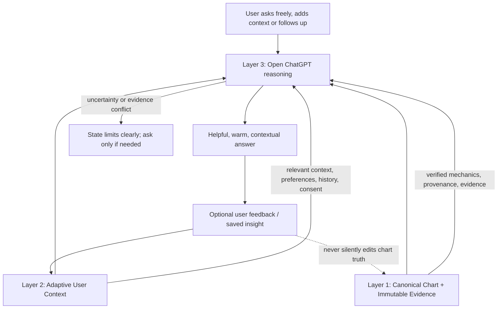

# 3framework testing

Status: working contract and test map  
Purpose: validate that the three-layer Know Yourself framework works as one coherent system. This is a test/documentation map, not a claim that all layers are already integrated or validated.

## Framework map

The user-facing reasoning layer remains open. Do not force the user through a predefined questionnaire or fixed set of questions. The user can ask any question and fill in details on the spot. The system may ask a concise clarifying question only when a missing detail materially affects the answer.

## Layer 1 — Canonical Chart + Immutable Evidence

**Purpose:** provide the authoritative, deterministic foundation for chart facts and source evidence.

Rules:
- Chart mechanics come from the deterministic chart engine, not from free-form LLM inference.
- Keep input data, calculation method/version, outputs, provenance, and evidence traceable.
- Keep natal definition separate from temporary transit activations and combined/overlay views.
- Do not silently change a chart fact because a user preference, memory, transit, or narrative suggests otherwise.
- If a value is unverified, conflicting, or unavailable, mark it as such.
- Never infer authority, channels, gates, lines, centres, or lifecycle activations from prose when validated engine output is available.
- Changes to calculation conventions require trusted reference validation and explicit review; do not switch true/mean node conventions based only on incomplete comparisons.

## Layer 2 — Adaptive User Context

**Purpose:** help the system remember what is relevant to this person and this conversation, without becoming a second source of chart truth.

### Context categories

1. **User-provided context**
   - Details the user explicitly shares about their situation, goals, lived experience, current question, and constraints.
   - Distinguish a user's statement from an externally verified fact.

2. **Preferences and response style**
   - Preferred tone, depth, terminology, language, interaction style, and known dislikes.
   - Current explicit instructions override older general preferences when they conflict.

3. **Conversation continuity**
   - Relevant prior questions, decisions, corrections, unresolved threads, and project state.
   - Retrieve only what is relevant to the current request; do not dump the whole history into every answer.

4. **Saved insights and reflections**
   - Insights the user explicitly chooses to save, plus their date, topic, and provenance.
   - Treat reflections as interpretations, not as deterministic chart facts or established truths about the user.

5. **User feedback and corrections**
   - Preserve durable corrections and decisions when appropriate.
   - A correction should trigger source re-checking and, where useful, a regression test—not merely a change in wording.

6. **Consent and lifecycle**
   - Respect consent for storage and use. Apply access controls, retention/expiry rules, and deletion requests.
   - If consent is absent, revoked, or ambiguous, do not use protected stored context. Ask only if needed to proceed.

### Context record contract

A context record should carry, where applicable:
- `id`: stable record identifier.
- `type`: preference, user_context, conversation_summary, decision, correction, saved_insight, or unresolved_question.
- `content`: concise human-readable content.
- `source`: user statement, conversation, explicit save, or other identifiable origin.
- `created_at` and `updated_at`.
- `relevance_tags` or topic labels.
- `consent_status`, access scope, and expiry/deletion status where relevant.
- `confidence/status`: explicit, inferred, tentative, disputed, or superseded.
- `related_chart_id` only when the record is actually tied to a specific chart.

Do not invent missing metadata. Keep inferred context visibly distinct from explicit user statements. A newer explicit correction supersedes a conflicting inference. Preserve prior versions only where the product's consent and retention rules allow it.

### Retrieval and use rules

- Retrieve context by relevance to the current question, recency when useful, and the user's explicit preferences—not simply by recency alone.
- Use the minimum relevant context needed to answer well.
- Separate **what the user said**, **what the chart engine verifies**, **what source material teaches**, and **what the reasoning layer infers**.
- Do not let memories alter the canonical chart, source evidence, or calculation outputs.
- Do not turn an old reflection into a permanent personality label.
- Do not infer sensitive personal facts or store sensitive context merely because it appeared in a conversation.
- If context conflicts, prefer the latest explicit user correction for their own preference or stated experience; for chart mechanics, use validated canonical output; for source claims, inspect the source. Explain unresolved conflicts.
- The user may correct, update, inspect, or ask to forget context. The system should acknowledge and apply those controls where supported.
- A missing memory is not proof that an event did not happen. Do not claim persistence unless the save and subsequent retrieval have been verified.

## Layer 3 — Open ChatGPT reasoning

**Purpose:** answer naturally and flexibly on top of Layers 1 and 2.

Rules:
- Open-ended chat is the default interaction. No mandatory form, scripted question tree, or fixed questionnaire.
- Answer the question the user actually asks; follow tangents and follow-up questions when relevant.
- Adapt the depth and tone to the user and situation.
- Use Layer 1 for chart mechanics, Layer 2 for relevant personal context, and source evidence for teaching claims.
- Make interpretations and hypotheses explicit as interpretations; never present them as deterministic chart output.
- Do not fabricate citations, memory, test results, saved state, or capabilities.
- When evidence is missing or contradictory, say what is known, what is uncertain, and why. Ask one targeted question only when the answer materially depends on it.
- The user remains in control of the direction of inquiry and can supply details at any point.

## Overall rules for all three layers

1. **Three layers only.** Do not reintroduce a five-layer architecture.
2. **Distinct responsibilities.** Canonical chart truth, adaptive personal context, and live reasoning are separate but connected.
3. **Evidence before certainty.** Never convert uncertainty into a confident claim.
4. **No silent cross-layer mutation.** Context and reasoning cannot rewrite canonical mechanics.
5. **Provenance matters.** Be able to tell whether a statement came from the engine, a source, the user, stored context, or an inference.
6. **Consent and privacy.** Use and persist personal context only within supported consent, access, retention, and deletion rules.
7. **Warm, personal, not mechanical.** Structure the backend rigorously; keep the conversation natural and inviting.
8. **No forced questioning.** Ask only for missing information that materially changes the answer.
9. **Transparent limits.** Clearly label unavailable features, incomplete integration, conflicting sources, and unverified tests.
10. **Continuity is not a claim of persistence.** Only report a save or retrieval as successful after verifying it.
11. **No unapproved platform or cost changes.** GitHub remains the project source of truth. Do not create a Lovable project or spend Lovable credits without explicit approval. Do not introduce Vercel as a dependency unless explicitly reopened.
12. **Regression after correction.** Durable corrections and repeated failures should inform a test or procedure that prevents recurrence.

## Cross-layer test map

Treat each test as **not yet passed** until its execution and result are recorded. Code coverage or a successful isolated unit test alone does not prove end-to-end framework operation.

| ID | Test | Expected result | Evidence needed |
|---|---|---|---|
| F1 | Canonical chart repeatability | Same inputs and engine version produce the same chart artifact/digest | Executed automated test and output |
| F2 | Provenance trace | Key chart facts can be traced to calculation output and method/version | Artifact inspection |
| F3 | Natal vs transit separation | Transit activations do not silently rewrite natal definition | Automated test plus response/UI inspection |
| F4 | Context relevance | Only context relevant to the current question is supplied to reasoning | Retrieval trace or fixture test |
| F5 | Consent boundary | Without valid consent, protected stored context is not injected | Automated negative test |
| F6 | Correction precedence | Latest explicit user correction overrides a conflicting older inference | Retrieval and reasoning fixture |
| F7 | Context cannot rewrite chart | A saved preference or reflection cannot change canonical chart facts | Cross-layer test |
| F8 | Open-ended reasoning | Free-form question is answered without requiring a predefined questionnaire | End-to-end ask test |
| F9 | Evidence-grounded interpretation | Answer distinguishes chart facts, teaching/source claims, user context, and inference | Response evaluation with cited evidence |
| F10 | Missing/conflicting evidence | Assistant states the limitation and does not guess | Negative/conflict fixture |
| F11 | Persistence round-trip | A consented save can be retrieved in a later session for the same authorized user | Authenticated save → new retrieval test |
| F12 | Full three-layer integration | One response demonstrably uses canonical facts plus relevant permitted context while reasoning remains open | End-to-end trace including input, retrieved context, chart evidence, response, and test result |

### Test reporting rule

For every test, record: status (**PASS / FAIL / BLOCKED / NOT RUN**), date, commit/version, exact test input, expected result, observed result, and evidence link. Do not label a test PASS based only on source inspection or a planned test.

## Current implementation note

This document defines the intended framework and its acceptance tests; it does **not** assert that every capability is currently integrated. In the previously inspected Lovable source, deterministic chart/evidence and open-ended ask handling were present, while persistent memories, conversation history, saved insights, and knowledge retrieval were not connected to the ask context. The health endpoint also reported persistence unavailable. Re-check the current source and run the tests before updating implementation status.

## Immediate validation sequence

1. Verify Layer 1 with repeatability, provenance, and natal/transit separation tests.
2. Test Layer 2 independently with consented context fixtures, relevance, correction precedence, and no-consent negatives.
3. Connect the permitted context to the open reasoning request without making the reasoning layer a fixed questionnaire.
4. Run F7, F9, F10, F11, and F12 end to end.
5. Update each status only from executed evidence and save the resulting checkpoint in `RESUME.md`.
