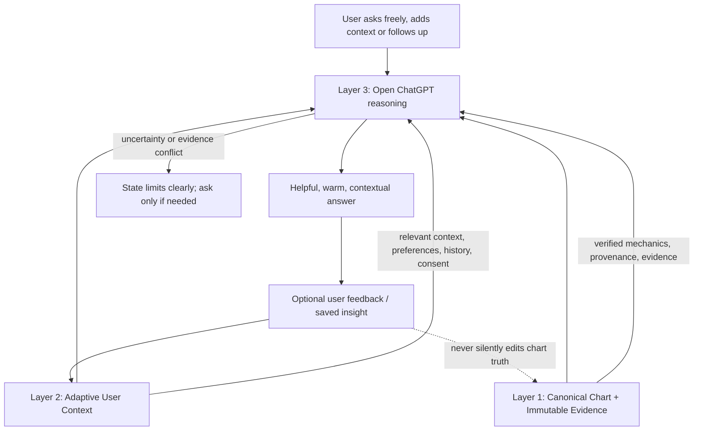

# 3framework testing

Status: working contract and test map  
Purpose: validate that the three-layer Know Yourself framework works as one coherent system. This is a test/documentation map, not a claim that all layers are already integrated or validated.

## Framework map

The user-facing reasoning layer remains open. Do not force the user through a predefined questionnaire or fixed set of questions. The user can ask any question and fill in details on the spot. The system may ask a concise clarifying question only when a missing detail materially affects the answer.

## Layer 1 — Canonical Chart + Immutable Evidence

**Purpose:** provide the authoritative, deterministic foundation for chart facts and source evidence.

Rules:
- Chart mechanics come from the deterministic chart engine, not from free-form LLM inference.
- Keep input data, calculation method/version, outputs, provenance, and evidence traceable.
- Keep natal definition separate from temporary transit activations and combined/overlay views.
- Do not silently change a chart fact because a user preference, memory, transit, or narrative suggests otherwise.
- If a value is unverified, conflicting, or unavailable, mark it as such.
- Never infer authority, channels, gates, lines, centres, or lifecycle activations from prose when validated engine output is available.
- Changes to calculation conventions require trusted reference validation and explicit review; do not switch true/mean node conventions based only on incomplete comparisons.

## Layer 2 — Adaptive User Context

**Purpose:** help the system remember what is relevant to this person and this conversation, without becoming a second source of chart truth.

### Context categories

1. **User-provided context**
   - Details the user explicitly shares about their situation, goals, lived experience, current question, and constraints.
   - Distinguish a user's statement from an externally verified fact.

2. **Preferences and response style**
   - Preferred tone, depth, terminology, language, interaction style, and known dislikes.
   - Current explicit instructions override older general preferences when they conflict.

3. **Conversation continuity**
   - Relevant prior questions, decisions, corrections, unresolved threads, and project state.
   - Retrieve only what is relevant to the current request; do not dump the whole history into every answer.

4. **Saved insights and reflections**
   - Insights the user explicitly chooses to save, plus their date, topic, and provenance.
   - Treat reflections as interpretations, not as deterministic chart facts or established truths about the user.

5. **User feedback and corrections**
   - Preserve durable corrections and decisions when appropriate.
   - A correction should trigger source re-checking and, where useful, a regression test—not merely a change in wording.

6. **Consent and lifecycle**
   - Respect consent for storage and use. Apply access controls, retention/expiry rules, and deletion requests.
   - If consent is absent, revoked, or ambiguous, do not use protected stored context. Ask only if needed to proceed.

### Context record contract

A context record should carry, where applicable:
- `id`: stable record identifier.
- `type`: preference, user_context, conversation_summary, decision, correction, saved_insight, or unresolved_question.
- `content`: concise human-readable content.
- `source`: user statement, conversation, explicit save, or other identifiable origin.
- `created_at` and `updated_at`.
- `relevance_tags` or topic labels.
- `consent_status`, access scope, and expiry/deletion status where relevant.
- `confidence/status`: explicit, inferred, tentative, disputed, or superseded.
- `related_chart_id` only when the record is actually tied to a specific chart.

Do not invent missing metadata. Keep inferred context visibly distinct from explicit user statements. A newer explicit correction supersedes a conflicting inference. Preserve prior versions only where the product's consent and retention rules allow it.

### Retrieval and use rules

- Retrieve context by relevance to the current question, recency when useful, and the user's explicit preferences—not simply by recency alone.
- Use the minimum relevant context needed to answer well.
- Separate **what the user said**, **what the chart engine verifies**, **what source material teaches**, and **what the reasoning layer infers**.
- Do not let memories alter the canonical chart, source evidence, or calculation outputs.
- Do not turn an old reflection into a permanent personality label.
- Do not infer sensitive personal facts or store sensitive context merely because it appeared in a conversation.
- If context conflicts, prefer the latest explicit user correction for their own preference or stated experience; for chart mechanics, use validated canonical output; for source claims, inspect the source. Explain unresolved conflicts.
- The user may correct, update, inspect, or ask to forget context. The system should acknowledge and apply those controls where supported.
- A missing memory is not proof that an event did not happen. Do not claim persistence unless the save and subsequent retrieval have been verified.

## Layer 3 — Open ChatGPT reasoning

**Purpose:** answer naturally and flexibly on top of Layers 1 and 2.

Rules:
- Open-ended chat is the default interaction. No mandatory form, scripted question tree, or fixed questionnaire.
- Answer the question the user actually asks; follow tangents and follow-up questions when relevant.
- Adapt the depth and tone to the user and situation.
- Use Layer 1 for chart mechanics, Layer 2 for relevant personal context, and source evidence for teaching claims.
- Make interpretations and hypotheses explicit as interpretations; never present them as deterministic chart output.
- Do not fabricate citations, memory, test results, saved state, or capabilities.
- When evidence is missing or contradictory, say what is known, what is uncertain, and why. Ask one targeted question only when the answer materially depends on it.
- The user remains in control of the direction of inquiry and can supply details at any point.

## Overall rules for all three layers

1. **Three layers only.** Do not reintroduce a five-layer architecture.
2. **Distinct responsibilities.** Canonical chart truth, adaptive personal context, and live reasoning are separate but connected.
3. **Evidence before certainty.** Never convert uncertainty into a confident claim.
4. **No silent cross-layer mutation.** Context and reasoning cannot rewrite canonical mechanics.
5. **Provenance matters.** Be able to tell whether a statement came from the engine, a source, the user, stored context, or an inference.
6. **Consent and privacy.** Use and persist personal context only within supported consent, access, retention, and deletion rules.
7. **Warm, personal, not mechanical.** Structure the backend rigorously; keep the conversation natural and inviting.
8. **No forced questioning.** Ask only for missing information that materially changes the answer.
9. **Transparent limits.** Clearly label unavailable features, incomplete integration, conflicting sources, and unverified tests.
10. **Continuity is not a claim of persistence.** Only report a save or retrieval as successful after verifying it.
11. **No unapproved platform or cost changes.** GitHub remains the project source of truth. Do not create a Lovable project or spend Lovable credits without explicit approval. Do not introduce Vercel as a dependency unless explicitly reopened.
12. **Regression after correction.** Durable corrections and repeated failures should inform a test or procedure that prevents recurrence.
13. **Visuals must be data-aligned.** General creative imagery is welcome when it adds warmth or understanding, but the concept, symbols, mood, and claims must connect to the actual question and available evidence. Chart-specific visuals must be generated from verified chart data, never guessed by an image model.

## Visual guidance — meaningful images, not generic decoration

Use images when they deepen understanding, improve emotional resonance, or clarify an idea. A general illustration is acceptable; it does not have to be a technical diagram. However, it must be aligned with the actual subject and the evidence available.

Rules:
- Choose a visual concept based on the actual question, verified chart facts, relevant source teaching, and consented user context—not just the broad topic “Human Design.”
- For interpretive topics, a creative/metaphorical illustration is fine if its metaphor accurately reflects the concept being explained. Do not imply that metaphorical artwork is canonical chart evidence.
- For chart mechanics (BodyGraph, gates, channels, centres, planetary activations, profile, Cross, transits), render or annotate from the deterministic chart data. Do not ask image generation to invent a technically accurate BodyGraph.
- If the image depicts a particular channel, gate, centre, or activation, verify that it is actually present in the relevant natal or transit state and label the state clearly.
- Distinguish natal definition from temporary transit conditioning in both visuals and captions.
- Do not use imagery that suggests a chart fact, personal trait, life event, or causal claim that the evidence does not support.
- Avoid repeated generic stock-like images or unrelated decorative images. Prefer one well-matched image over several weak matches.
- If no relevant visual can be made reliably, use no image.
- Where feasible, attach the visual to a short explanation of why it relates to the answer; provide alt text.
- Evaluate relevance and data accuracy separately: a beautiful image can still fail if it is unrelated or implies incorrect chart mechanics.

### Visual regression checks
- V1: Image concept directly matches the question's specific subject.
- V2: Any chart details match verified engine output.
- V3: Natal and transit activations are not conflated.
- V4: Metaphorical artwork is not presented as mechanical evidence.
- V5: If no relevant visual is available, the answer omits the image rather than filling space with decoration.

## Human Design interpretation rule — channels and Sacral Authority

The system must not reduce advanced channel/authority questions to generic channel keywords. In particular, when interpreting a Generator with Sacral Authority, it should inspect which defined channels connect directly to the Sacral Centre and explain how Human Design source material describes their relationship to Sacral energy/response. This is an interpretive teaching claim, so it must be grounded in the project's knowledge sources or clearly labelled external research—not invented from general model associations.

For the user's currently recorded six channels (3–60, 11–56, 28–38, 32–54, 34–57, 42–53), the channels directly connecting to the Sacral Centre are recorded as:
- **3–60** (Root–Sacral)
- **34–57** (Sacral–Spleen)
- **42–53** (Sacral–Root)

The other three recorded channels do not directly connect to the Sacral Centre. This structural distinction is not by itself enough to claim exactly how a person's response will feel or to establish a source's advanced doctrine. The answer should investigate circuitry, channel mechanics, and the distinction between authority as decision-making mechanism versus channels as defined energy pathways. Avoid the oversimplification that channels are merely “themes” with no influence on the Sacral response; also avoid claiming they replace or independently override Sacral Authority unless the cited source explicitly supports that statement.

Required response behavior:
- Verify the canonical chart facts first.
- Retrieve relevant advanced teaching with provenance.
- Explain the interaction in layers: mechanical connection to Sacral; source teaching about that channel/circuit; cautious personal synthesis.
- Distinguish official/source teaching from broader Human Design interpretation and KY synthesis.
- Where source materials disagree or are silent, say so and do not manufacture a single definitive doctrine.
- Do not assume the mere presence of a channel proves a specific subjective bodily reaction for the user.

## Cross-layer test map

Treat each test as **not yet passed** until its execution and result are recorded. Code coverage or a successful isolated unit test alone does not prove end-to-end framework operation.

| ID | Test | Expected result | Evidence needed |
|---|---|---|---|
| F1 | Canonical chart repeatability | Same inputs and engine version produce the same chart artifact/digest | Executed automated test and output |
| F2 | Provenance trace | Key chart facts can be traced to calculation output and method/version | Artifact inspection |
| F3 | Natal vs transit separation | Transit activations do not silently rewrite natal definition | Automated test plus response/UI inspection |
| F4 | Context relevance | Only context relevant to the current question is supplied to reasoning | Retrieval trace or fixture test |
| F5 | Consent boundary | Without valid consent, protected stored context is not injected | Automated negative test |
| F6 | Correction precedence | Latest explicit user correction overrides a conflicting older inference | Retrieval and reasoning fixture |
| F7 | Context cannot rewrite chart | A saved preference or reflection cannot change canonical chart facts | Cross-layer test |
| F8 | Open-ended reasoning | Free-form question is answered without requiring a predefined questionnaire | End-to-end ask test |
| F9 | Evidence-grounded interpretation | Answer distinguishes chart facts, teaching/source claims, user context, and inference | Response evaluation with cited evidence |
| F10 | Missing/conflicting evidence | Assistant states the limitation and does not guess | Negative/conflict fixture |
| F11 | Persistence round-trip | A consented save can be retrieved in a later session for the same authorized user | Authenticated save → new retrieval test |
| F12 | Full three-layer integration | One response demonstrably uses canonical facts plus relevant permitted context while reasoning remains open | End-to-end trace including input, retrieved context, chart evidence, response, and test result |

### Test reporting rule

For every test, record: status (**PASS / FAIL / BLOCKED / NOT RUN**), date, commit/version, exact test input, expected result, observed result, and evidence link. Do not label a test PASS based only on source inspection or a planned test.

## Current implementation note

This document defines the intended framework and its acceptance tests; it does **not** assert that every capability is currently integrated. In the previously inspected Lovable source, deterministic chart/evidence and open-ended ask handling were present, while persistent memories, conversation history, saved insights, and knowledge retrieval were not connected to the ask context. The health endpoint also reported persistence unavailable. Re-check the current source and run the tests before updating implementation status.

## Immediate validation sequence

1. Verify Layer 1 with repeatability, provenance, and natal/transit separation tests.
2. Test Layer 2 independently with consented context fixtures, relevance, correction precedence, and no-consent negatives.
3. Connect the permitted context to the open reasoning request without making the reasoning layer a fixed questionnaire.
4. Run F7, F9, F10, F11, and F12 end to end.
5. Update each status only from executed evidence and save the resulting checkpoint in `RESUME.md`.

## Cross-cutting mechanism — 3Framework Orchestrator (3FO)

The 3Framework Orchestrator is **not a fourth layer**. It is the coordination mechanism intertwined with Layers 1, 2, and 3. It manages the permitted flow between canonical evidence, adaptive context, and open reasoning.

Responsibilities:
- Resolve the user's current question and determine which canonical facts, source evidence, and permitted context are relevant.
- Retrieve only context allowed by consent and access rules.
- Pass chart facts and provenance separately from user memories and interpretive material.
- Keep the reasoning layer open-ended; do not require a fixed questionnaire.
- Prevent Layer 2 or Layer 3 from silently mutating Layer 1.
- Carry uncertainty and conflicts through to the final answer instead of hiding them.
- When the user asks to save a question, memory, or insight, invoke an explicit persistence path if available; verify the write and later retrieval before claiming success.
- Record enough trace information in tests to establish which evidence and context informed a response, without unnecessarily logging sensitive content.

### Orchestrator acceptance tests

| ID | Test | Expected result | Evidence needed |
|---|---|---|---|
| O1 | Routing | A free-form question reaches the open reasoning path with relevant chart/context inputs | Request/response trace |
| O2 | Separation | Canonical evidence and user context remain separately typed/provenanced | Context payload inspection |
| O3 | Consent enforcement | Orchestrator excludes context not authorized for this request | Negative test and retrieval trace |
| O4 | No canonical mutation | User memory or reasoning output cannot alter chart artifact/digest | Before/after artifact comparison |
| O5 | Conflict propagation | Conflicting evidence is surfaced, not silently resolved by the model | Conflict fixture |
| O6 | Question save | A question explicitly selected for saving is stored with source, timestamp, consent/access scope, and topic metadata | Authenticated write plus database read-back |
| O7 | Question retrieval | A later relevant question can retrieve the saved question as context for the same authorized user | New-session retrieval trace |
| O8 | Save control | Ordinary questions are not silently promoted to durable memory unless the product's clearly communicated save policy and consent permit it | UI/behavior test |
| O9 | End-to-end coordination | One response uses verified chart evidence and permitted context while remaining open-ended | Full trace and test report |

## Can Adaptive User Context save questions?

**Architecturally, yes.** Questions can be a first-class context record, for example `type: unresolved_question` or `type: conversation_question`, with the original wording, timestamp, topic tags, source conversation/turn reference, and consent/access status. The system should distinguish:
- **Question history:** what the user asked, retained under the product's conversation-history policy.
- **Open question / unresolved thread:** a question the user wants to return to.
- **Saved insight:** a conclusion or reflection the user explicitly wants to keep.
- **Durable preference/correction:** information useful across future conversations.

A question should not automatically be treated as a fact about the user. For example, asking about a relationship issue does not prove that the user is experiencing that issue. The user should be able to say “save this question” or explicitly mark it for follow-up. If automatic conversation history is later enabled, its retention and consent rules must be clear and configurable.

**Current implementation status: not yet verified as working end to end.** The previously inspected ask-context code did not connect persistent conversation history, saved insights, memories, or knowledge retrieval, and its health endpoint reported persistence unavailable. Therefore, the architecture supports saving questions, but we cannot yet promise that the current app stores and retrieves them. O6 and O7 must pass against an authenticated persistence service before this can be called operational.

## Readiness gate

The framework is ready for **structured testing now**, but not yet certified as fully integrated. Start with deterministic Layer 1 tests and isolated Layer 2/orchestrator fixtures; then run authenticated persistence round-trip and full cross-layer tests. Do not describe question saving as functional until O6/O7 pass with verified read-back.
